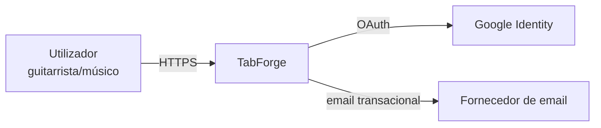
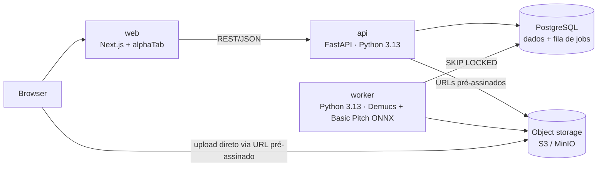
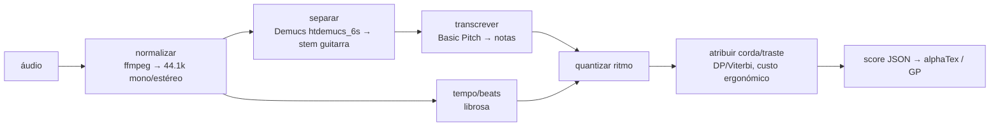

# Arquitetura — TabForge

Estado: **Proposta** (aguarda aprovação — gate da Fase 2).

## C4 — Nível 1 (Contexto)



## C4 — Nível 2 (Containers)



| Container | Responsabilidade | Tecnologia |
|---|---|---|
| `apps/web` | UI, render/playback/edição de tab | Next.js 16, TypeScript strict, alphaTab 1.9 (MPL-2.0) |
| `services/api` | Auth, CRUD, criação de jobs, URLs pré-assinados, rate limiting | FastAPI, SQLAlchemy 2, Alembic |
| `services/worker` | Pipeline de transcrição | Python 3.13, Demucs 4.1 (MIT), Basic Pitch 0.4 (backend ONNX, sem TensorFlow) |
| PostgreSQL | Dados + fila (`jobs` com `FOR UPDATE SKIP LOCKED`) | Postgres 17 |
| Object storage | Áudio, stems, MIDI intermédio | S3 em produção, MinIO em dev |

Sem Redis/broker no MVP: a fila em Postgres chega para o volume previsto e remove um serviço (ADR-0001).

## Pipeline de transcrição (worker)



- Etapas `B–E` são modelos de terceiros atrás de interfaces (`Separator`, `Transcriber`, `BeatTracker`) → substituíveis.
- Etapas `F–G` são **domínio próprio**, deterministas, com TDD (onde está o diferencial).
- Upload de stem já isolada (opção do utilizador) salta a etapa `C`.

## Modelo de dados (inicial)

```mermaid
erDiagram
  USER ||--o{ AUDIO_ASSET : uploads
  USER ||--o{ TAB : owns
  AUDIO_ASSET ||--o{ JOB : processed_by
  JOB ||--o| TAB : produces
  TAB ||--o{ TAB_REVISION : has
  USER { uuid id; text email; timestamptz created_at; timestamptz deleted_at }
  AUDIO_ASSET { uuid id; uuid user_id; text storage_key; text sha256; int duration_ms; timestamptz expires_at }
  JOB { uuid id; uuid audio_id; text status; text stage; int attempts; text error_code; timestamptz locked_at }
  TAB { uuid id; uuid owner_id; text title; text tuning; text visibility; uuid current_revision_id }
  TAB_REVISION { uuid id; uuid tab_id; jsonb score; text source; timestamptz created_at }
```

- `JOB.status`: `queued | running | done | failed`; `stage`: `separating | transcribing | arranging`.
- `TAB.visibility`: `private` (default) `| unlisted | public` (public desativado até ADR-0003 ser fechado).
- `TAB_REVISION` imutável; `source`: `ai | user`.

## Contrato de API (rascunho)

| Método | Rota | Descrição |
|---|---|---|
| `POST` | `/v1/uploads` | Devolve URL pré-assinado (PUT) + `audio_id`; valida tamanho declarado |
| `POST` | `/v1/uploads/{id}/complete` | Valida magic bytes/duração; cria job |
| `GET` | `/v1/jobs/{id}` | Estado + etapa |
| `GET` | `/v1/tabs/{id}` | Tab + revisão atual |
| `POST` | `/v1/tabs/{id}/revisions` | Nova revisão (edição) |
| `GET` | `/v1/tabs/{id}/export?format=gp\|midi` | Export |
| `GET` | `/health`, `/ready` | Liveness / readiness |

OpenAPI gerado automaticamente pelo FastAPI (`/openapi.json`) é a fonte de verdade.

## Erros, logging, configuração

- Erros: RFC 9457 (`application/problem+json`) com `code` estável.
- Logging: JSON estruturado, `request_id`/`job_id` correlacionados; sem emails nem nomes de ficheiro do utilizador.
- Config: env vars (12-factor); `.env.example` versionado.

## Threat model (STRIDE — top ameaças)

| # | Ameaça | Categoria | Mitigação |
|---|---|---|---|
| T1 | Ficheiro malicioso disfarçado de áudio (exploit em decoder ffmpeg) | Tampering / EoP | Validação por magic bytes; ffmpeg em container sem rede, utilizador não-root, limites CPU/mem/tempo; ffmpeg atualizado |
| T2 | Acesso a tabs/áudio de outro utilizador (IDOR) | Info disclosure | Autorização por `owner_id` em todas as queries; UUIDs; testes de autorização por rota |
| T3 | Abuso de GPU (DoS por custo) | DoS | Quotas por utilizador/dia, duração máx., rate limiting, dedupe por SHA-256 |
| T4 | Roubo de sessão | Spoofing | Cookies `HttpOnly`/`Secure`/`SameSite=Lax`, CSRF token, CSP estrita |
| T5 | XSS via título/metadados da tab ou alphaTex | Tampering | Escape no output; alphaTex gerado no servidor a partir de JSON validado (schema), nunca texto livre do utilizador |
| T6 | Fuga de URLs pré-assinados | Info disclosure | Expiração ≤ 5 min; bucket privado; sem listagem |
| T7 | Conteúdo protegido publicado | Repúdio / legal | Privado por defeito; declaração de titularidade; takedown e audit log (ADR-0003) |

## Decisões (ADRs)

- [ADR-0001](adr/0001-monorepo-e-stack.md) — Monorepo e stack
- [ADR-0002](adr/0002-pipeline-transcricao.md) — Pipeline de transcrição e isolamento do worker
- [ADR-0003](adr/0003-politica-conteudo-direitos-autor.md) — Política de conteúdo e direitos de autor
