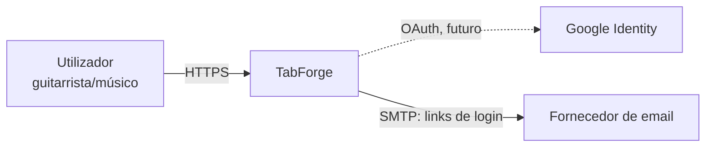
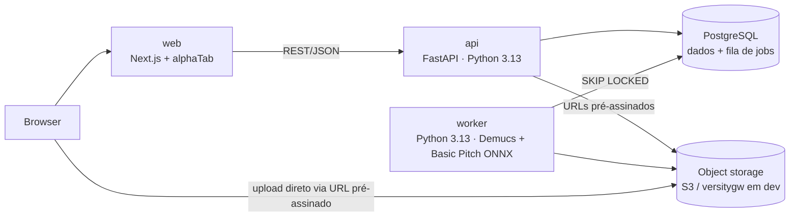
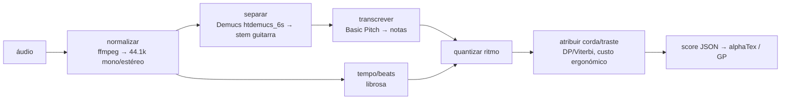

# Arquitetura — TabForge

Estado: **Proposta** (aguarda aprovação — gate da Fase 2).

## C4 — Nível 1 (Contexto)



## C4 — Nível 2 (Containers)



| Container | Responsabilidade | Tecnologia |
|---|---|---|
| `apps/web` | UI, render/playback/edição de tab | Next.js 16, TypeScript strict, alphaTab 1.9 (MPL-2.0) |
| `services/api` | Auth, CRUD, criação de jobs, URLs pré-assinados, rate limiting | FastAPI, SQLAlchemy 2, Alembic |
| `services/worker` | Pipeline de transcrição | Python 3.13, Demucs 4.1 (MIT), Basic Pitch 0.4 (backend ONNX, sem TensorFlow) |
| PostgreSQL | Dados + fila (`jobs` com `FOR UPDATE SKIP LOCKED`) | Postgres 17 |
| Object storage | Áudio, stems, MIDI intermédio | S3 em produção, versitygw em dev (ADR-0004) |

Sem Redis/broker no MVP: a fila em Postgres chega para o volume previsto e remove um serviço (ADR-0001).

## Pipeline de transcrição (worker)



- Etapas `B–E` são modelos de terceiros atrás de interfaces (`Separator`, `Transcriber`, `BeatTracker`) → substituíveis.
- Etapas `F–G` são **domínio próprio**, deterministas, com TDD (onde está o diferencial): `services/worker/src/tabforge_worker/arrange/` (quantização em grelha de 12 ticks/batida, Viterbi corda/traste, layout para Score v2). Resultados em `docs/eval/M2-arranging.md`.
- **Afinação (ADR-0013):** antes do arranjo, `arrange/tuning.detect_tuning` escolhe a afinação a partir das notas transcritas: o chão das notas graves (4 % das notas, mínimo 12, acima de Lá1) escolhe a afinação mais alta cuja corda grave lá chega, entre E/Eb/D/C#/C/B standard e Drop D/C#/C/B/A; entre standard e drop com a mesma corda grave, a drop só se o Viterbi a tocar com ≥ 5 % menos esforço. Lead e Rhythm usam a mesma; o nome fica em `tabs.tuning`. Resultados em `docs/eval/M3-tuning.md`.
- O worker escolhe o pipeline por `TABFORGE_WORKER_PIPELINE` (`stub` sem ML, `real` com o extra `ml`).
- Upload de stem já isolada (opção do utilizador) salta a etapa `C`.
- **Aprendizagem da corda/traste (ADR-0011):** no ciclo do worker (ao arrancar e de 30 em 30 s, `TABFORGE_WORKER_TUNING_S`), `profiles.refresh_next` reclama o `FRETTING_PROFILE` `stale` mais antigo com `FOR UPDATE SKIP LOCKED` enquanto lê os dados de treino e afina sem prender a linha (`learning.tune`). Dados por tab: as notas da tab certa (todas as pistas com referência; afinação das cordas lida das notas, senão a da pista da tab); sem referência, a última revisão `user` se as notas forem diferentes das da primeira revisão `ai` (`score_events` por pista). Notas com o mesmo início formam um evento (acorde). Até 5 000 notas (tabs inteiras, mais recentes primeiro). Pesquisa em grelha de 175 combinações (`span` = 1, só as razões contam; `height` −0,1…0,4 — negativo favorece trastes altos; `move` 0,1…2; `open_move` 0…1) mais os pesos por omissão; medida = notas com corda **e** traste iguais às da tab certa. Com ≥ 3 tabs, validação cruzada "deixar uma tab de fora" (cada tab é colocada com os pesos melhores nas outras); com 1 ou 2 tabs (ADR-0016), as partes deixadas de fora são as duas metades no tempo de cada pista. Os pesos só são aceites se essa precisão for maior que a dos pesos por omissão. Menos de 200 notas → `insufficient`. Se o perfil for marcado de novo durante a afinação, o resultado fica gravado mas o estado continua `stale`. Um perfil cuja afinação falha vai para o fim da fila (`fretting_profile_failed`). Evento de log `fretting_profile_updated` (ids, contagens e precisões). Tempo medido: 4–7 s para 5 000 notas numa core (o Viterbi prepara as formas de cada evento uma vez e reutiliza-as em todas as combinações).
- **Uso dos pesos:** `run_once` lê os pesos aceites do dono do job (`status = ready` e `weights` não nulo) e passa-os ao arranjo (`ClaimedJob.weights` → `arrange_guitar`/`arrange_lead_rhythm`), na guitarra isolada (v2) e nas pautas Lead/Rhythm (v3); sem perfil em uso, os pesos por omissão. As tabs já geradas não mudam. O pipeline stub ignora-os.

## Modelo de dados (inicial)

```mermaid
erDiagram
  USER ||--o{ AUDIO_ASSET : uploads
  USER ||--o{ TAB : owns
  AUDIO_ASSET ||--o{ JOB : processed_by
  JOB ||--o| TAB : produces
  TAB ||--o{ TAB_REVISION : has
  TAB ||--o{ TAB_REFERENCE : compared_with
  USER ||--o| FRETTING_PROFILE : learns
  USER ||--o{ SESSION : has
  USER { uuid id; text email; timestamptz created_at; timestamptz deleted_at }
  SESSION { uuid id; uuid user_id; text token_hash; text csrf_token; timestamptz expires_at }
  LOGIN_TOKEN { uuid id; text email; text token_hash; timestamptz expires_at; timestamptz used_at }
  AUDIO_ASSET { uuid id; uuid user_id; text status; text source_kind; text content_type; bigint size_bytes; text storage_key; text sha256; int duration_ms; timestamptz expires_at }
  JOB { uuid id; uuid audio_id; text status; text stage; int attempts; text error_code; timestamptz locked_at; uuid tab_id }
  TAB { uuid id; uuid owner_id; text title; text tuning; text visibility; uuid current_revision_id }
  TAB_REVISION { uuid id; uuid tab_id; jsonb score; text source; timestamptz created_at }
  TAB_REFERENCE { uuid id; uuid tab_id; int track_index; text filename; text track; jsonb notes; timestamptz created_at }
  FRETTING_PROFILE { uuid user_id; jsonb weights; float default_accuracy; float tuned_accuracy; int tabs; int notes; text status; timestamptz requested_at; timestamptz updated_at }
```

- `AUDIO_ASSET.status`: `pending_upload | uploaded | rejected`; `source_kind`: `mix | guitar_stem` (escolha do utilizador no upload).
- `JOB.status`: `queued | running | done | failed`; `stage`: `normalizing | separating | transcribing | arranging`. `guitar_stem` salta `separating` (ADR-0002, decisão M0).
- Códigos de erro do job: `audio_too_long` (> 10 min), `audio_unreadable` (ffmpeg não lê o ficheiro no formato declarado), `<etapa>_failed` (erro interno nessa etapa), `max_attempts_exceeded`.
- Fila: o worker reclama o job `queued` mais antigo (ou `running` com lease expirado) com `FOR UPDATE SKIP LOCKED`; cada etapa renova `locked_at`. Acima de 3 tentativas o job falha com `max_attempts_exceeded`; erro numa etapa → `failed` com `<etapa>_failed`.
- Schema: migrações Alembic em `services/api/migrations` (a API é dona do schema; o worker usa SQL via psycopg).
- `TAB.visibility`: `private` (default) `| unlisted | public` (public desativado até ADR-0003 ser fechado).
- `TAB_REVISION` imutável; `source`: `ai | user`. `score`: Score v1/v2 (uma pista) ou v3 (`tracks`: 1 a 4 pistas com `name`, `tuning`, `bars`, `warnings`, todas com o mesmo número de compassos; ADR-0010). O worker ainda grava v2.
- `TAB_REFERENCE` (ADR-0009, ADR-0010): no máximo uma por pista da tab (`tab_id` + `track_index` únicos; `track_index` ≥ 0 é o índice da pista no score, 0 em v1/v2 e nas referências anteriores à migração 0006); `track` é o nome da pista no ficheiro Guitar Pro; `notes` é uma lista JSONB de `{onset (semínimas), pitch, string (1 = mais aguda), fret, bar}`. Só ficam as notas, nunca o ficheiro Guitar Pro. Apaga-se em cascata com a tab.
- `FRETTING_PROFILE` (ADR-0011, migração 0007): um por utilizador (`user_id` é a chave e FK para `users`, apagado em cascata com a conta). `weights` = pesos aceites `{span, height, move, open_move}` ou null; `default_accuracy`/`tuned_accuracy` = posições exatas com os pesos por omissão e com os afinados (validação cruzada com ≥ 3 tabs, senão no próprio conjunto); `tabs`/`notes` = dados de treino usados; `status`: `stale` (por atualizar) `| ready | insufficient`. A API faz upsert `status = stale`, `requested_at = now()` (num savepoint, sem nunca falhar o pedido) ao guardar ou apagar uma tab certa, ao aplicar correções (`applied` > 0), ao guardar uma revisão e em `POST /v1/me/tuning`.
- `LOGIN_TOKEN` e `SESSION` (US-07, ADR-0006) guardam só o SHA-256 do segredo. `SESSION` e todo o conteúdo do utilizador apagam-se em cascata com `USER`; `LOGIN_TOKEN` não tem FK (existe antes do utilizador) e é apagado pelo email. O worker remove os expirados de hora a hora.

## Contrato de API (rascunho)

| Método | Rota | Descrição |
|---|---|---|
| `POST` | `/v1/auth/magic-link` | `{email}` → 202 `{}` sempre que o email é válido (sem enumeração); 422 email inválido; 429 `rate_limited` (5/15 min por email, 20/15 min por IP); 503 `mail_unavailable` |
| `POST` | `/v1/auth/verify` | `{token}` → 200 `{user: {id, email}, csrf_token}` + cookie de sessão; 400 `invalid_token` (inválido, expirado ou já usado) |
| `GET` | `/v1/auth/session` | 200 `{user, csrf_token}` (`csrf_token: null` no fallback `dev_auth`); 401 `unauthenticated` |
| `POST` | `/v1/auth/logout` | 204; apaga a sessão e limpa o cookie; idempotente (exige CSRF se houver sessão) |
| `DELETE` | `/v1/me` | 204; apaga áudio no storage e depois o utilizador (cascata: áudio, jobs, tabs, revisões, tabs certas, perfil de aprendizagem, sessões); 503 `storage_unavailable` sem apagar nada |
| `GET` | `/v1/me/tuning` | Perfil de aprendizagem da corda/traste (ADR-0011) → 200 `{status: none\|stale\|ready\|insufficient, tabs, notes, default_accuracy, tuned_accuracy, in_use, weights: {span, height, move, open_move} ou null, updated_at, min_notes: 200, min_tabs: 2}`; `none` sem perfil; `in_use` = `ready` com `weights`; precisões arredondadas a 4 casas |
| `POST` | `/v1/me/tuning` | "Atualizar agora" (CSRF e limite de escritas): marca o perfil `stale` → 202 com o mesmo corpo do `GET`; o worker atualiza-o no ciclo seguinte (≤ 30 s) |
| `POST` | `/v1/uploads` | `{content_type, size_bytes, source_kind}` → URL pré-assinado (PUT, assina `Content-Type` e `Content-Length`, ≤ 5 min) + `audio_id`; 413/415 |
| `POST` | `/v1/uploads/{id}/complete` | Confirma tamanho e magic bytes (se não coincidirem: apaga, 415); cria job `queued` |
| `GET` | `/v1/jobs/{id}` | Estado + etapa |
| `DELETE` | `/v1/jobs/{id}` | Só do dono (CSRF e limite de escritas). Apaga a música: o áudio guardado (primeiro; se falhar → 503 `storage_unavailable` e nada é apagado), a tarefa e a tab que produziu (revisões e tabs certas incluídas; havendo tab certa, marca o perfil de aprendizagem `stale`) → 204; 409 `job_running` enquanto o worker a transcreve; 404. A cópia em Música\TabForge (ADR-0014) fica |
| `GET` | `/v1/tabs/{id}` | Tab + revisão atual (score v1/v2/v3) + alphaTex gerado no servidor (v3: `\track` por pista) |
| `DELETE` | `/v1/tabs/{id}` | Como `DELETE /v1/jobs/{id}`, a partir da tab: apaga a tab e a tarefa e o áudio de onde veio → 204; 409 `job_running`; 404 |
| `POST` | `/v1/tabs/{id}/revisions` | Nova revisão (edição); aceita Score v1/v2/v3 |
| `POST` | `/v1/tabs/{id}/preview` | `{score}` → `{alphatex}` sem gravar (o editor redesenha a partir daqui) |
| `PUT` | `/v1/tabs/{id}/reference?track=N` | Só do dono. Guarda a tab certa da pista `N` (inteiro ≥ 0, por defeito 0; ADR-0010) como notas (ADR-0009): `{filename, track, notes: [{onset, pitch, string, fret, bar}]}` (1–20 000 notas, corpo ≤ 2 MB); substitui a anterior dessa pista → 200 `{filename, track, notes, created_at}`; 422 `invalid_track` se a revisão atual não tem a pista `N`; 413/422 |
| `GET` | `/v1/tabs/{id}/reference?track=N` | Resumo da tab certa da pista `N` (por defeito 0); 404 `reference_not_found` |
| `DELETE` | `/v1/tabs/{id}/reference?track=N` | Apaga a da pista `N` (por defeito 0); 204 (idempotente); se havia uma, marca o perfil de aprendizagem `stale` |
| `GET` | `/v1/tabs/{id}/comparison?track=N` | Compara a pista `N` (por defeito 0) da revisão atual com a tab certa dessa pista: deslocamento, escala, recall, precision, F1, posição correta, erro de ataque e resultados por compasso; 422 `invalid_track` se a revisão atual não tem a pista `N`; 404 `reference_not_found`; devolve também `differences`: `{counts: {position, missing, extra, timing}, items: [{kind, bar, onset, pitch, ai: {string, fret, bar, beat} ou null, ref: {string, fret} ou null, onset_error}], truncated}` — `position` = nota encontrada noutra corda/traste, `timing` = mesma posição com ataque a mais de 1/8 de semínima, `missing` = nota da tab certa não encontrada, `extra` = nota da pauta sem correspondência; `items` por ordem de ataque, no máximo 500 (`counts` é sempre completo; `beat` conta a partir de 0); `tab_tuning`/`reference_tuning` (MIDI, corda 1 primeiro) e `tab_tuning_name`/`reference_tuning_name` ("E standard", "Drop D"…): com afinações diferentes as posições não coincidem até aplicar as correções |
| `POST` | `/v1/tabs/{id}/comparison/apply?track=N` | Só do dono (CSRF e limite de escritas como nas revisões). `{base_revision_id, kinds: ["position"]}`: corrige a corda e o traste das notas da pista `N` (por defeito 0) que diferem da tab certa, também nas ligaduras (`tie`) dessas notas, todas ao mesmo tempo (acordes podem trocar de corda; uma nota a mais que ocupe a corda de destino passa para a corda livre mais próxima com o mesmo som); salta a correção se a corda de destino continua ocupada, o traste fica fora do braço ou o pitch mudaria. Se a tab certa estiver noutra afinação (lida das notas: pitch − traste por corda), a pista passa para essa afinação e as outras notas mantêm o som (na mesma corda ou na livre mais próxima); se alguma não couber, a afinação fica. Cria uma revisão nova (`source` `user`) e torna-a atual → 201 `{tab, applied, skipped, retuned_to}` (`tab` como na gravação de revisões; `retuned_to` = nome da afinação nova ou null; o nome da afinação da tab muda quando todas as pistas ficam iguais); se nada mudar → 200 com a tab inalterada e sem revisão nova; 422 `unsupported_correction` (só `position`) ou `invalid_track`; 404 `reference_not_found`; 409 `revision_conflict` |
| `POST` | `/v1/imports/youtube` | **Só `env=desktop`** (ADR-0014; noutros ambientes não existe). `{url, source_kind}`: só links do YouTube (`youtube.com`, `www.`/`m.`/`music.youtube.com`, `youtu.be`; sem credenciais nem porta) → 422 `invalid_youtube_url`. Descarrega com o yt-dlp (Node do pacote como runtime de JavaScript), duração verificada antes (> 10 min → 422 `audio_too_long`), MP3 de 192 kbps com o ffmpeg do pacote (> 50 MB → 413); guarda-o como um upload terminado, põe o job na fila e copia o MP3 para `Música\TabForge` → 201 `{job, title, mp3_path}`; falha do yt-dlp → 502 `download_failed` (mensagem do yt-dlp); yt-dlp em falta → 501 `unavailable` |
| `GET` | `/health`, `/ready` | Liveness / readiness |
| `POST` | `/v1/auth/desktop` | Só `env=desktop` (senão 404): `{token}` → 200 `{user, csrf_token}` + cookie de sessão; 403 `invalid_launch_token`; 429 `rate_limited` (10/min por IP) |
| `PUT` | `/v1/local-storage/{key}` | Só com storage `local`: upload assinado (`expires`, `sig`) → 200 sem corpo; 403 `invalid_signature`/`upload_url_expired`; 400 `invalid_key`/`upload_size_mismatch`; 411 `length_required` |

OpenAPI gerado automaticamente pelo FastAPI (`/openapi.json`) é a fonte de verdade. Implementado: auth e conta (US-07), uploads, jobs, tabs e revisões, tab certa e comparação (ADR-0009), aprendizagem da corda/traste (`/v1/me/tuning`, ADR-0011), `/health`, `/ready`. O export Guitar Pro/MIDI (US-05) é feito no browser com o alphaTab, sem endpoint (ADR-0007).

### Validação de uploads (US-01)

- Tipo e tamanho declarados validados ao criar o upload (415/413); o URL pré-assinado assina ambos, por isso o storage rejeita outro conteúdo (403).
- Ao completar: tamanho real (HEAD) e magic bytes (GET com `Range`, 12 bytes). A API nunca descodifica áudio (T1).
- **Duração (≤ 10 min) é verificada no worker** (etapa `normalizing`, ffprobe), não na API: obrigaria a API a descodificar input não confiável. Consequência: um ficheiro longo devolve `failed` com `audio_too_long` no job, em vez de 413 no upload. Desvio ao critério de US-01, registado aqui.
- ffmpeg/ffprobe correm com o demuxer forçado pelo tipo declarado (já validado pelos magic bytes), só o protocolo `file` e timeouts (`services/worker/src/tabforge_worker/media.py`).

### Autenticação (US-07, ADR-0006)

- **Login por link mágico** (sem passwords). O link `{web_base_url}/login/verify#token=…` leva o token no fragmento (fora de logs e `Referer`); a página do web envia-o em `POST /v1/auth/verify`. Token de 256 bits, uso único, 15 min, guardado só como SHA-256; consumo atómico (`UPDATE … WHERE used_at IS NULL AND expires_at > now() RETURNING`).
- **Sessão opaca** em Postgres (`sessions`, 30 dias). Cookie `tabforge_session`: `HttpOnly; Secure; SameSite=Lax; Path=/`. `Secure` só se desliga em dev por http (`TABFORGE_SESSION_COOKIE_SECURE=false`).
- **CSRF:** pedidos `POST/PUT/PATCH/DELETE` autenticados por cookie enviam `X-CSRF-Token` com o `csrf_token` da sessão (devolvido por `verify` e `GET /v1/auth/session`); falta ou diferente → 403 `csrf_failed`.
- **`get_current_user`:** cookie de sessão válido; senão o fallback `dev_auth` (só `env=dev`, utilizador fixo, sem CSRF); senão 401. As rotas dependem só desta função.
- **CORS** com credenciais só para as origens em `TABFORGE_CORS_ORIGINS` (`*` recusado no arranque).
- **Email:** SMTP genérico (stdlib). Dev: Mailpit (`docker compose`, UI em `http://localhost:8025`). Sem `TABFORGE_SMTP_HOST`, em dev o link vai para o log da API; noutros ambientes a API não arranca.
- **Eliminação de conta (RGPD art. 17):** `DELETE /v1/me` apaga primeiro os objetos de áudio (porta `ObjectStore`); se o storage falhar, 503 e nada é apagado, para o utilizador repetir. Depois apaga os `login_tokens` do email e o utilizador (cascata). Um job em curso cujo dono foi apagado termina sem efeito no worker (`job_gone`).
- Google OAuth: no backlog.

## Modo desktop (ADR-0008)

Aplicação Windows para um só utilizador, sem servidor. Os mesmos serviços correm com `TABFORGE_ENV=desktop`; o comportamento online (`dev`/`test`/`prod`, S3, link mágico, CSRF) não muda.

- **Configuração (falha fechada):** `env=desktop` exige `storage_backend=local`, `local_storage_dir`, `desktop_launch_token` e `local_upload_secret` (segredos com ≥ 32 caracteres) e um `api_public_url` em loopback (por defeito `http://127.0.0.1:47801`). `storage_backend=local` só é aceite com `env=desktop` ou `env=test`. `dev_auth` continua só em `env=dev`.
- **Login:** o programa de arranque gera um token por arranque; `POST /v1/auth/desktop` compara-o em tempo constante e abre a sessão do utilizador local `local@tabforge.desktop` com o mesmo código de `verify` (cookie e token CSRF do ADR-0006). Sem SMTP: em desktop o mailer está desativado e `POST /v1/auth/magic-link` e `POST /v1/auth/verify` respondem 404 `not_found`.
- **Só loopback:** em desktop a API recusa (400) pedidos cujo `Host` não seja `127.0.0.1` ou `localhost` (`TrustedHostMiddleware` do Starlette, compara só o nome, não a porta), contra DNS rebinding.
- **Armazenamento:** `LocalObjectStore` implementa a porta `ObjectStore` numa pasta. As chaves passam por uma allow-list por segmento (`[A-Za-z0-9._-]`, sem `.`/`..`, ponto final ou nomes reservados do Windows) e o caminho resolvido tem de ficar dentro da pasta (também contra symlinks). `presign_put` devolve `{api_public_url}/v1/local-storage/{key}?expires=…&sig=…`, com HMAC-SHA256 (`local_upload_secret`) sobre método, chave, validade, `Content-Type` e `Content-Length`, validade ≤ 300 s.
- **Upload assinado:** `PUT /v1/local-storage/{key}` só existe com storage `local`. A assinatura é a autorização (sem cookie nem CSRF, como um URL pré-assinado do S3): o pedido tem de trazer exatamente o `Content-Type` e o `Content-Length` assinados. O corpo vai para um ficheiro temporário na mesma pasta, cortado no tamanho assinado (corpo a mais ou a menos → 400 e o temporário é apagado), e só no fim é renomeado. CORS para as mesmas origens configuradas, com `PUT` só neste modo (a web corre em `http://127.0.0.1:47800`).
- **Worker:** `TABFORGE_STORAGE_BACKEND=local` + `TABFORGE_LOCAL_STORAGE_DIR` selecionam `LocalAudioSource`, que copia o ficheiro para a pasta do job e apaga-o na retenção (mesma verificação de chave, duplicada no worker porque os serviços só partilham o pacote do score). A eliminação de conta usa a porta `ObjectStore` da API, por isso apaga também os ficheiros locais. `TABFORGE_FFMPEG`/`TABFORGE_FFPROBE` apontam para os binários embutidos (por defeito `ffmpeg`/`ffprobe` do `PATH`). O programa de arranque corre o loop numa thread com `run_forever(config, threading.Event())`.

## Erros, logging, configuração

- Erros: RFC 9457 (`application/problem+json`) com `code` estável.
- Logging: JSON estruturado, `request_id`/`job_id` correlacionados; sem emails nem nomes de ficheiro do utilizador.
- Config: env vars (12-factor); `.env.example` versionado.

## Threat model (STRIDE — top ameaças)

| # | Ameaça | Categoria | Mitigação |
|---|---|---|---|
| T1 | Ficheiro malicioso disfarçado de áudio (exploit em decoder ffmpeg) | Tampering / EoP | Validação por magic bytes; ffmpeg em container sem rede, utilizador não-root, limites CPU/mem/tempo; ffmpeg atualizado |
| T2 | Acesso a tabs/áudio de outro utilizador (IDOR) | Info disclosure | Autorização por `owner_id` em todas as queries; UUIDs; testes de autorização por rota |
| T3 | Abuso de GPU (DoS por custo) | DoS | Quotas por utilizador/dia, duração máx., rate limiting, dedupe por SHA-256 |
| T4 | Roubo de sessão / CSRF | Spoofing | Sessão opaca no servidor (só o SHA-256 do cookie em BD, revogável no logout); cookie `HttpOnly`/`Secure`/`SameSite=Lax`; token CSRF sincronizador em `X-CSRF-Token` para métodos que alteram estado; link de login de uso único, 15 min, no fragmento do URL; 5 links/15 min por email e 20 por IP; CSP estrita (web) |
| T5 | XSS via título/metadados da tab ou alphaTex | Tampering | Escape no output; alphaTex gerado no servidor a partir de JSON validado (schema), nunca texto livre do utilizador |
| T6 | Fuga de URLs pré-assinados | Info disclosure | Expiração ≤ 5 min; bucket privado; sem listagem |
| T7 | Conteúdo protegido publicado | Repúdio / legal | Privado por defeito; declaração de titularidade; takedown e audit log (ADR-0003) |

## Decisões (ADRs)

- [ADR-0001](adr/0001-monorepo-e-stack.md) — Monorepo e stack
- [ADR-0002](adr/0002-pipeline-transcricao.md) — Pipeline de transcrição e isolamento do worker
- [ADR-0003](adr/0003-politica-conteudo-direitos-autor.md) — Política de conteúdo e direitos de autor
- [ADR-0004](adr/0004-s3-de-desenvolvimento.md) — Object storage de desenvolvimento: versitygw em vez de MinIO
- [ADR-0005](adr/0005-pacote-partilhado-score.md) — Pacote partilhado do score e Score v2
- [ADR-0006](adr/0006-autenticacao.md) — Autenticação: link mágico por email e sessões opacas no servidor
- [ADR-0007](adr/0007-export-no-browser.md) — Export Guitar Pro e MIDI no browser com o alphaTab
- [ADR-0008](adr/0008-aplicacao-desktop-windows.md) — Aplicação desktop para Windows (uso pessoal, só CPU)
- [ADR-0009](adr/0009-comparacao-com-tab-certa.md) — Comparação com a tab certa dentro do TabForge
- [ADR-0010](adr/0010-pautas-lead-e-rhythm.md) — Pautas Lead e Rhythm (Score v3 com pistas)
- [ADR-0011](adr/0011-aprender-com-as-tabs-certas.md) — Aprender a escolha de corda/traste com as tabs certas e as correções
- [ADR-0012](adr/0012-instalador-so-a-pedido.md) — Instalador Windows só a pedido; em cada push testa-se o start.bat
- [ADR-0013](adr/0013-detetar-a-afinacao.md) — Detetar a afinação da guitarra a partir das notas transcritas
- [ADR-0014](adr/0014-importar-do-youtube.md) — Importar áudio de um link do YouTube (só no desktop)
- [ADR-0015](adr/0015-ci-so-quando-faz-falta.md) — Workflows do GitHub Actions só quando o que testam muda (Windows, Docker e CodeQL deixam de correr em cada push)
- [ADR-0016](adr/0016-aprender-com-uma-tab-e-refazer-posicoes.md) — Aprender com uma tab certa (validação por metades) e refazer as posições de uma tab existente com os pesos aprendidos
